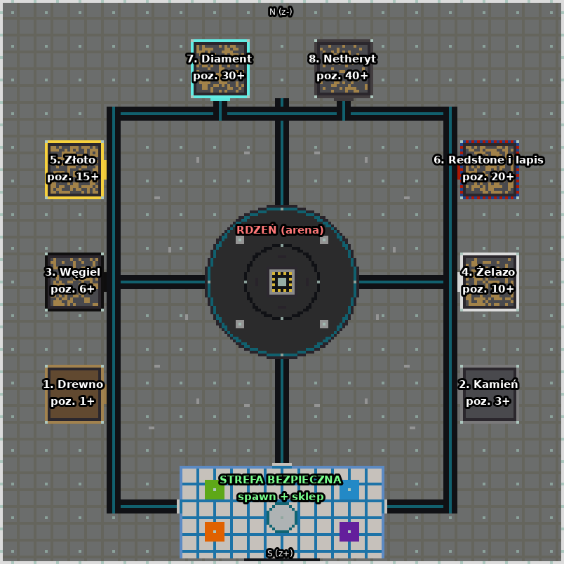

# Mapa BoxPvP: „Serwerownia”

Mapa trybu BoxPvP w stylu mchosting.pl: gracze walczą w środku wielkiej serwerowni. Ściany to szafy serwerowe z mrugającymi diodami, podłoga to płyty z kanałami kablowymi, na środku stoi „procesor” (arena), a kopalnie to „dyski” w obudowach z ramą z bloków swojego surowca.

## Układ (200 × 200, środek w 0, 0)

Północ to góra obrazka (z ujemne). Podłoga jest na y = 64, gracz stoi na y = 65.

| Strefa | Gdzie | Co tam jest |
|---|---|---|
| Strefa bezpieczna (spawn) | x −36…36, z 66…99 | Spawn (0, 66, 84), 4 budki z NPC: Skup surowców, Ulepszenia kilofa, Sklep: sprzęt, Schowek. Duży ekran z napisem „mchosting.pl BoxPvP” i miejsca na rankingi. PvP wyłączone. |
| Rdzeń (arena PvP) | koło o promieniu 26 wokół 0, 0 | Okrągła arena z 4 wejściami, wieżami chłodzącymi jako osłony i podwyższonym „procesorem” na środku (przyszły event „Król wzgórza”). |
| Kopalnie 1–6 | po bokach, x ±74 | Od dołu (blisko spawnu) do góry: Drewno, Kamień, Węgiel, Żelazo, Złoto, Redstone i lapis. |
| Kopalnie 7–8 | na północy, z −76 | Diament i Netheryt, najdalej od spawnu, trzeba przejść przez środek mapy. |
| Korytarze | czarne ścieżki z błękitną linią | Spawn → arena → północ, boczne alejki przy bramach kopalń. |

Każda kopalnia ma 17 × 17 bloków i 9 warstw w głąb. Wejście przez bramę 5 bloków szerokości, nad bramą napis z nazwą i wymaganym poziomem.

| Kopalnia | Poziom | Skład |
|---|---|---|
| 1. Drewno | 1 | dąb, brzoza, świerk |
| 2. Kamień | 3 | kamień, bruk, andezyt |
| 3. Węgiel | 6 | kamień 60%, węgiel 40% |
| 4. Żelazo | 10 | kamień 55%, żelazo 35%, węgiel 10% |
| 5. Złoto | 15 | łupek 55%, złoto 35%, żelazo 10% |
| 6. Redstone i lapis | 20 | łupek 50%, redstone 25%, lapis 25% |
| 7. Diament | 30 | łupek 60%, diament 30%, szmaragd 10% |
| 8. Netheryt | 40 | netherrack 55%, czernit 25%, pradawne szczątki 12%, złoto netherowe 8% |

Poziomy i skład to pierwsza propozycja. Zmienia się je w `generator.py` (lista `MINES`), potem trzeba uruchomić generator jeszcze raz.

## Pliki

- `generator.py`: buduje mapę. Uruchomienie: `python3 generator.py` (potrzebny Python 3 z `numpy` i `Pillow`).
- `strefy.json`: koordynaty stref dla przyszłego pluginu `mchosting-boxpvp` (spawn, strefa bezpieczna, NPC, rankingi, arena, każda kopalnia: obszar do odnawiania, obszar wejścia, brama, punkt wejścia, skład bloków, poziom). Plik jest generowany, nie edytuj go ręcznie.
- `podglad.png`: widok z góry.
- `build/boxpvp-datapack.zip`: paczka danych (nie jest w repo, powstaje po uruchomieniu generatora).

## Jak wgrać na serwer

1. Świat BoxPvP powinien być pusty (void), np. w `server.properties`: `level-type=minecraft\:flat` i `generator-settings={"layers":[{"block":"minecraft:air","height":1}],"biome":"minecraft:the_void"}`. Najlepiej też `spawn-monsters=false`.
2. Wgraj `boxpvp-datapack.zip` do `world/datapacks/`.
3. W konsoli: `reload`, potem `function boxpvp:build`. Mapa buduje się w kilku etapach (kilka sekund), na końcu pojawia się „Mapa gotowa”.
4. Wejście na spawn: `/function boxpvp:tp`.
5. Odnowienie kopalni ręcznie: `function boxpvp:reset/wegiel` (albo `reset/all`). Docelowo robi to plugin co kilka minut i najpierw wyrzuca graczy z kopalni.

Jeśli po `reload` paczka nie jest widoczna (`datapack list`), trzeba poprawić `min_format`/`max_format` w `pack.mcmeta` (w generatorze) pod wersję serwera.

## Co zostaje dla pluginu

Mapa sama nic nie pilnuje. Plugin `mchosting-boxpvp` ma wczytać `strefy.json` i:
- blokować niszczenie i stawianie bloków poza obszarami `fill` kopalń,
- wyłączyć PvP w `safeZone`, wpuszczać do kopalni (`area`) tylko graczy z wymaganym poziomem,
- odnawiać kopalnie co `resetMinutes` według `blocks` (losowo z wagami), wcześniej przenosząc graczy na `entry`,
- postawić NPC i rankingi w podanych miejscach.

Wszystko poza strefą bezpieczną to PvP, łącznie z kopalniami i korytarzami.
