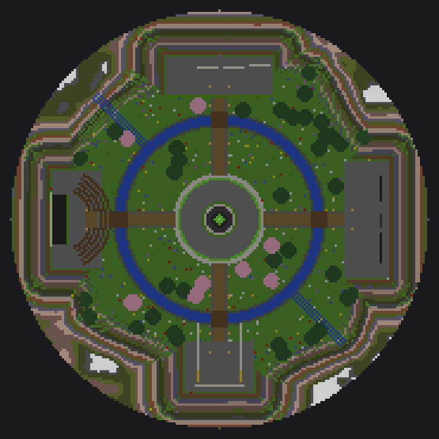
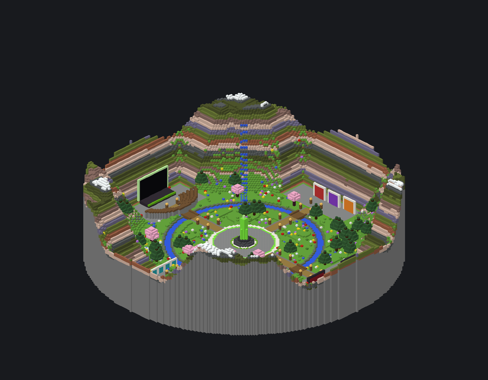

# Mapa huba: „Dolina”

Hub sieci: zamknięta dolina (ok. 145 × 145 kratek) otoczona górami z wodospadami. Na szczycie gór stoi niewidzialna ściana, więc nikt nie wyjdzie poza mapę.

## Co gdzie jest

| Miejsce | Gdzie | Co tam jest |
|---|---|---|
| Spawn | środek (0, 101, 10) | kryształ z napisem mchosting.pl, plac, wokół rzeka z mostkami |
| Minigry | północ | 4 bramy: Spleef, TNT Run, Parkour, Duels |
| Tryby | wschód | bramy BoxPvP, LifeSteal SMP, OneBlock („wkrótce”) |
| Aleja serwerów | południe | 15 miejsc na portale do serwerów klientów, złote „Serwer TOP” |
| Amfiteatr | zachód | scena i ekran na eventy |

Mapa stoi na wysokości 92–183, podłoga doliny na y 100, środek w 0, 0.

## Pliki

- `generator.py`: buduje mapę. Uruchomienie: `python3 generator.py` (potrzebny Python 3 z `numpy` i `Pillow`). Wszystkie ustawienia (wielkość, położenie bram, drzewa) są w tym pliku.
- `colors.py`: kolory bloków do podglądu.
- `podglad.png`: widok z góry (generator tworzy go od nowa). Pozostałe `podglad-*.png` to starsze widoki 3D i oczami gracza.
- `build/hub-datapack.zip`: paczka danych (nie jest w repo, powstaje po uruchomieniu generatora).

## Jak wgrać na serwer

1. Świat huba najlepiej pusty (void), tak jak przy BoxPvP: w `server.properties` `level-type=minecraft\:flat` i `generator-settings={"layers":[{"block":"minecraft:air","height":1}],"biome":"minecraft:the_void"}`. Na zwykłym świecie też zadziała, ale wokół doliny będzie normalny teren.
2. Wgraj `hub-datapack.zip` do `world/datapacks/`.
3. W konsoli: `reload`, potem `function hub:build`. Mapa buduje się w 6 częściach (kilka sekund), postęp widać na pasku akcji, na końcu pojawia się „Hub gotowy”. Spawn świata ustawia się sam.
4. Wejście na spawn: `/function hub:tp`.

Jeśli po `reload` paczka nie jest widoczna (`datapack list`), trzeba poprawić `min_format`/`max_format` w `pack.mcmeta` (w generatorze) pod wersję serwera.
